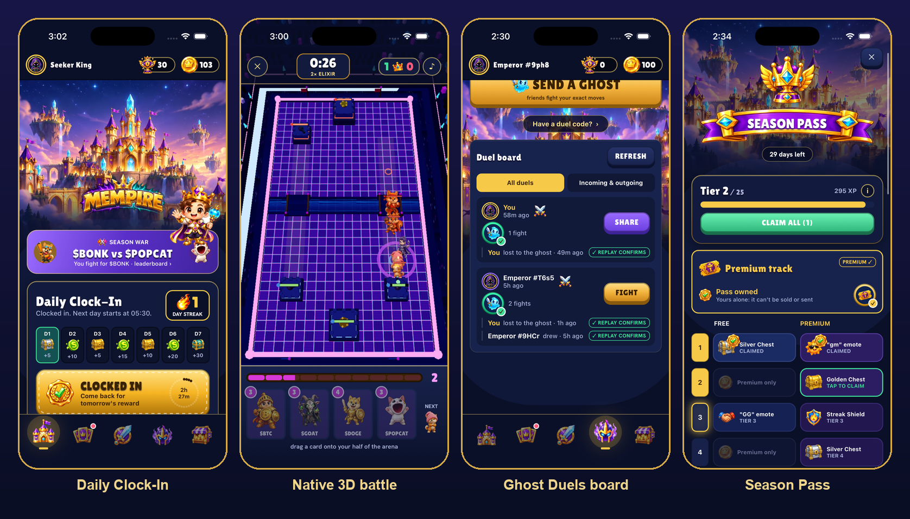
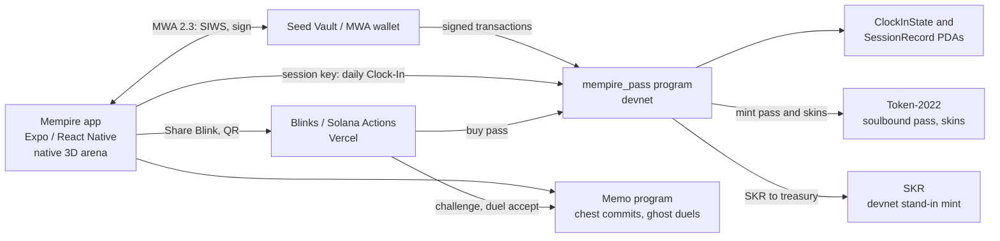

# Mempire for Seeker

**Clock in. Fight. Rule the season.**

A native Solana Mobile card battler where every coin is a fighter. Clock in once a day to keep a streak that lives on Solana, play 30-second battles in a native 3D arena, send friends a ghost of your match to beat, and climb a soulbound Season Pass paid in SKR.

[](https://github.com/nickthelegend/mempire-clockin/releases/tag/clockin-v1)
[](https://explorer.solana.com/address/3aykd5NLqwjALGiaPykRiGJhv1ehJsjxqVsjQ5qGtr7G?cluster=devnet)
[](clockin/E2E-AUDIT.md)

- **APK:** [`clockin-v1` release](https://github.com/nickthelegend/mempire-clockin/releases/tag/clockin-v1): `mempire-clockin.apk`, version 1.6.3 (versionCode 16), sha256 `d3928c765feec83f3adb600f6e08f73db1be857117c623cad614fdc0d88f383f`
- **Demo video:** link in the hackathon submission
- **Devnet program (`mempire_pass`):** [`3aykd5NLqwjALGiaPykRiGJhv1ehJsjxqVsjQ5qGtr7G`](https://explorer.solana.com/address/3aykd5NLqwjALGiaPykRiGJhv1ehJsjxqVsjQ5qGtr7G?cluster=devnet)
- **Network:** Solana devnet only. No real funds move.



## Why Seeker users come back daily

- **A streak worth keeping.** One tap a day pays a 7-day ladder of chests and SKR, with a Legendary chest on day 7. Each Clock-In is recorded in an on-chain PDA, an evening reminder fires before the streak lapses, and SKR buys a Streak Shield so one missed day doesn't reset it.
- **A full session in under a minute.** Three daily quests, a chest timer that pings you when it's ready, and a 30-second Rush match. The AI Coach on the phone plays your deck against every rival and suggests one swap.
- **Reasons that come from other people.** Ghost Duels let a friend fight your exact recorded moves, and the result is re-simulated from chain. Your side in the BONK vs POPCAT Season War is tallied from everyone's Clock-Ins, and the 25-tier Season Pass runs for a month.

## Solana and Solana Mobile tech

Every proof link below is a real devnet transaction from the [end-to-end audit](clockin/E2E-AUDIT.md), run in the Release build and read back with `getTransaction`.

| Feature | How | Proof |
|---|---|---|
| **MWA + Seed Vault** | Mobile Wallet Adapter 2.3 is the primary wallet on Android: Seed Vault on Seeker, or Phantom and Solflare. The auth token is kept in the OS keystore, and every transaction is approved in the wallet. A labelled devnet-only dev wallet covers iOS. | [`wallet.ts`](mobile/src/wallet/wallet.ts). Not yet run on Android hardware |
| **Sign In With Solana** | MWA `authorize` with a SIWS payload (domain, nonce, `solana:devnet`), so Seed Vault connects and signs in with one sheet. The ed25519 signature is verified on the phone. | Off-chain, audit row 2 |
| **Session key** | One wallet approval creates a 7-day `SessionRecord` PDA. After that, daily Clock-Ins and chest commits are signed by the session key with no prompt. Revoking it returns the fee float. | [create](https://explorer.solana.com/tx/3NdvsuiqKhbyrJKry3MpRZrXtzbUbGYGiQNyoyJndTBo1fU2fHhbmpai9uCduDHDp2B7dcS4zWq66WCSRTbQC1mf?cluster=devnet) · [session-signed Clock-In](https://explorer.solana.com/tx/39R1fweqjUaDTMfrZxKsauDJF7as1QywXCRc7GYQeULuqx4N9g9iCpc68JBzTZHdGgUBbQTmy21FzQBp9GivnUC8?cluster=devnet) · [revoke](https://explorer.solana.com/tx/A9Tj8b8bSnRVD5xFR8SzZQRjyxc7E3nm9KYstapttMVbMc7N3VkGEbWZfPeE1zhRQvUgJSG17h4QdJQf79nMXFs?cluster=devnet) |
| **Clock-In PDA** | `clock_in` writes a `ClockInState` PDA (day, streak, war side), allowed once per UTC day (`AlreadyClockedIn`). The same transaction carries a memo and mints the day's SKR. | [Clock-In](https://explorer.solana.com/tx/5bxhhCP7TteXeqwAFg8FB29YqT4jfsMiAu14uv46c6PW4JQKFkZKUyRwSJ58TNLkYJH77M5z4GPQh7i4oWyw813?cluster=devnet) |
| **Provably fair chests** | Each chest commits on chain to a slot 32 slots ahead, before that block exists. `sha256(blockhash ‖ chestId ‖ owner)` then drives the drop table, and **Verify → Recompute** re-derives the drops in the app. This uses Solana slot hashes, not a VRF. | [commit](https://explorer.solana.com/tx/5bxhhCP7TteXeqwAFg8FB29YqT4jfsMiAu14uv46c6PW4JQKFkZKUyRwSJ58TNLkYJH77M5z4GPQh7i4oWyw813?cluster=devnet) · [deciding block](https://explorer.solana.com/block/509981107?cluster=devnet) |
| **Ghost Duels** | A match's input log is posted on chain. A friend opens it from a link or QR code, fights the same seed in the native arena, and the result is re-simulated from chain before it gets a ✓. | [ghost posted](https://explorer.solana.com/tx/4iKK9ebU9L2Z3AVbBBCyf5sTPhr8o1ZKbhdqRxwjWFSXrvrbvyi1xvshngeZj9mdYqJhLPGCdgEs3YNNUYcxPRav?cluster=devnet) · [fought, result posted](https://explorer.solana.com/tx/4VhBjmmUW5krucyUxxcE5CChujMCXsmtJxgvea2g5mN4CtFSgidmPEbGus32VhJJFrQ9mQ5E8nhxoahx1PdCmFx5?cluster=devnet) |
| **Season Pass (Token-2022, soulbound)** | `buy_pass` takes 150 SKR to a treasury vault and mints a NonTransferable token with MetadataPointer and TokenMetadata, all in one instruction. A receipt PDA blocks a second purchase. Premium status comes from what the chain says the wallet holds. | [buy pass](https://explorer.solana.com/tx/2a8db2SEzGjvZfTz71ABLPByTZZSKCwsHLrj6CD55uaVTg5WEfM4UueUDBHUZjCsGhimsRsiyQ7k2nfWDTPNS9Bj?cluster=devnet) |
| **Skins for SKR** | Arena skins and card frames are transferable Token-2022 tokens with on-chain metadata, bought with `buy_skin` and rendered by the native 3D arena. | [buy skin](https://explorer.solana.com/tx/42EZEWyqRGQR1EGZhFBgQPH3Shwf6aXD9A7woFJk4nZSYZ78HTvTScGshHkpXZ2QExiphC4CvE1Cb4G3S4ywZEM7?cluster=devnet) |
| **Season War** | BONK vs POPCAT. Your side is written into every Clock-In (PDA field plus memo), and the phone tallies the global war from chain. | [BONK pledge](https://explorer.solana.com/tx/39R1fweqjUaDTMfrZxKsauDJF7as1QywXCRc7GYQeULuqx4N9g9iCpc68JBzTZHdGgUBbQTmy21FzQBp9GivnUC8?cluster=devnet) |
| **Blinks** | Solana Actions on Vercel ([mempire-actions.vercel.app](https://mempire-actions.vercel.app)): Challenge a friend, Accept a duel (also a Solana Pay QR), and Buy Season Pass. | [challenge](https://explorer.solana.com/tx/4s1QTnagqAxhP49AouUr5xodoSxAVtVbawp33iRhYP4W2jb3LgaKiNUKpw73MkrK4uGue8MD2Zz7oYRVowz2bUWp?cluster=devnet) · [QR duel accept](https://explorer.solana.com/tx/2PktR8gM1C9XCqRaYSaZxZJpBHHWtAmq5e1wBZS8xpPbxFsSaXaTExKAonbKhAmDKYhVTj7uqoTGa2a2rsUGJ8oa?cluster=devnet) |
| **Seeker Genesis Token** | A read-only mainnet check for a Token-2022 account in the SGT group (`GT22s89n…`). Holders earn double SKR on every Clock-In. | [`seeker.ts`](mobile/src/chain/seeker.ts). Not tested with a real SGT holder |

## SKR integration

SKR is the currency of consistency: you earn it by showing up and spend it on staying in the game. It never buys power.

- **Earn:** 5 to 30 SKR per Clock-In on the 7-day ladder, plus SKR for wins and daily quests. Seeker Genesis Token holders earn double.
- **Spend:** Streak Shield (15), Seeker Chest (40), Rush Unlock (8), the Season Pass (150, paid into a treasury vault by `buy_pass`), and skins (60 for an arena skin, 25 for a card frame).
- **On devnet, a stand-in mint.** Real SKR doesn't exist on devnet, so the app uses a clearly labelled stand-in, [`AWruExU2…`](https://explorer.solana.com/address/AWruExU2wyLGxFBqAeDs1YtNKJtbo9ucdGKWENaXY6ez?cluster=devnet), with the same shape as SKR: classic SPL, 6 decimals, `transferChecked`. The public `spl-token-faucet` program holds its mint authority, so the Clock-In transaction mints the reward and no key ships in the APK.
- **Mainnet SKR is ready.** The real SKR mint (`SKRbvo6Gf7GondiT3BbTfuRDPqLWei4j2Qy2NPGZhW3`) is already in the code, and the app reads the wallet's real mainnet SKR balance (read-only). Moving payments to it needs a mainnet deploy of `mempire_pass` and a config change. That hasn't been done yet.
- **No staking.**

## Architecture



## Install

1. Download `mempire-clockin.apk` from the [`clockin-v1` release](https://github.com/nickthelegend/mempire-clockin/releases/tag/clockin-v1) and check it: `shasum -a 256 mempire-clockin.apk` should print `d3928c765feec83f3adb600f6e08f73db1be857117c623cad614fdc0d88f383f`.
2. Install it on a Seeker or any Android phone (allow installs from this source), or use `adb install mempire-clockin.apk`.
3. Open the app and tap **Connect Wallet** (Seed Vault or any MWA wallet), or **Use dev wallet**. Fund the address with devnet SOL from [faucet.solana.com](https://faucet.solana.com) for on-chain Clock-Ins.

### Build from source

```bash
cd mobile && npm install
npm run ios:sim                # iOS simulator (dev wallet)
npm run apk                    # signed release APK; needs the MEMPIRE_KEYSTORE* env vars (see HANDOFF.md)
cd ../app && npx vitest run    # game and chain tests (152 at 1.6.3)
cd ../chain/pass && anchor test   # mempire_pass on a local validator
```

## What's verified

- **End-to-end audit on live devnet** ([`clockin/E2E-AUDIT.md`](clockin/E2E-AUDIT.md)). The Release build ran on the iPhone 17 simulator with no Metro, and every on-chain step was read back with `getTransaction`. That covers the Clock-In, session key, chests, Season Pass, skins, Season War, Ghost Duels and Blinks. Failures found during the audit were fixed and re-checked.
- **A devnet sweep with the app's own transaction builders**: 13 transactions in [`clockin/DEVNET-EVIDENCE.md`](clockin/DEVNET-EVIDENCE.md).
- **Tests:** 152/152 app tests; `anchor test` for `mempire_pass`; negative cases simulated on real devnet accounts (a soulbound transfer, a second pass purchase, a second Clock-In on the same day, a stranger's Clock-In).
- **Not yet verified on Android hardware.** The APK is built and signed with Gradle, but it hasn't been run on a phone or emulator. MWA and Seed Vault, the native arena's frame rate on a real GPU, notification delivery, and the Seeker Genesis Token perk with a real holder all still need a device. On the simulator, OpenGL is software-rendered at 3 to 4 fps, so in Auto mode the arena falls back to the bundled web arena.

Full status and commands: [HANDOFF.md](HANDOFF.md). Submission material: [`clockin/`](clockin/).

---

## Feature details (Seeker app)

`mobile/` is an Expo 57 / React Native 0.86 app, and it is native end to end.
The 3D battle is the web game's own React Three Fiber scene, rendered natively
with `@react-three/fiber/native` on `expo-gl`. It sits under a native HUD, with
drag-to-deploy, the shared deterministic simulation, and the same AI rival.

| | What it does | Where |
|---|---|---|
| **Mobile Wallet Adapter** | Primary sign-in on Android (Seed Vault on Seeker, Phantom, Solflare). Auth token kept in the OS keystore, every transaction approved in the wallet. A clearly labelled **devnet-only dev wallet** covers iOS and wallet-less emulators. | `mobile/src/wallet/wallet.ts` |
| **Daily Clock-In** | One tap a day. A 7-day reward ladder (chests and SKR, Legendary chest on day 7), streak + best streak, reminders before the streak lapses. Each Clock-In is a `mempire_pass::clock_in` instruction that updates the wallet's `ClockInState` PDA, plus a signed memo (`mempire:clockin:v1:day=…:streak=…`), so the streak is a public record anyone can rebuild from chain. | `mobile/src/game/rules.ts`, `mobile/src/chain/clockin.ts` |
| **SKR** | Earned by clocking in and winning; spent on **Streak Shields** (miss a day, keep the streak), a **Seeker Chest**, and **Rush Unlock**. Never on power. On devnet it is a labelled stand-in mint with real SKR's shape (classic SPL, 6 decimals, `transferChecked`), paid out by the public `spl-token-faucet` program so no key ships in the app. **Seeker Genesis Token** holders earn double SKR (read-only mainnet check). | `mobile/src/chain/skr.ts`, `mobile/src/chain/seeker.ts` |
| **AI Coach (on-device)** | Runs the game's real deterministic battle engine headless on the phone: your deck vs every rival, both seats, fixed seeds — then searches for the single swap from your collection that wins more, and shows the numbers behind it. No server, no LLM, nothing leaves the device. | `mobile/src/game/coach.ts` |
| **First run** | A three-beat intro (Clock-In, battle, SKR), then a guided 30-second first battle with touch-through coach marks and a Golden welcome chest. Skippable, and replayable from settings. | `mobile/src/screens/Intro.tsx`, `CoachMarks.tsx` |
| **Daily quests** | Clock in, win a battle, deploy 10 cards. They reset at UTC midnight, pay SKR, and finishing all three adds a Silver chest. There is also an evening streak-at-risk reminder and a "Challenge a friend" share (deep link plus web fallback). | `mobile/src/game/rules.ts`, `src/notify.ts` |
| **Season Pass (Token-2022)** | 25 tiers, free + premium, XP from clock-ins, quests and battles; rewards are chests, chest slots, Streak Shields, frames and emotes — never stats. The premium pass is a **soulbound Token-2022 token** (NonTransferable + MetadataPointer + TokenMetadata) bought for SKR from the `mempire_pass` program in one instruction; premium is whatever the chain says the wallet holds. Live on devnet since Oct 11 (`clockin/DEVNET-EVIDENCE.md`). | `chain/pass/`, `mobile/src/chain/pass.ts`, `mobile/src/game/season.ts` |
| **Skins & wardrobe** | 3 arena skins (Neon Night, Golden Hour, Frozen Ledger) rendered by the native 3D arena from baked texture variants, and 4 card frames — transferable Token-2022 tokens with on-chain metadata, sold for SKR, equipped in Deck → Wardrobe. | `app/src/three/skin.ts`, `mobile/src/screens/Shop.tsx` |
| **Season War, board, share card** | BONK vs POPCAT: your side is written into each Clock-In (the `ClockInState` war side and the memo), and the global tally is read from chain on the phone. A per-coin board of your battles, and a result share card (image + challenge link). Unlicensed company fighters are hidden from the mobile build. | `mobile/src/game/board.ts`, `mobile/src/screens/ShareCard.tsx` |
| **Sign In With Solana** | One tap: MWA `authorize` with a SIWS payload (domain, nonce, issuedAt, `solana:devnet`), so Seed Vault authorizes and signs in one sheet. The ed25519 signature and the signed fields are verified on the phone ("Signed in with Seed Vault"). Wallets without SIWS sign the same message via `signMessages`. On iOS the dev wallet signs it locally. | `mobile/src/chain/siws.ts`, `mobile/src/wallet/wallet.ts` |
| **.skr names** | The player's `.skr` (AllDomains, read-only mainnet, cached, 6 s cap) replaces the address in the header, wallet sheet, share card and leaderboard row, and never blocks: the short address shows until the name arrives. **Find a Seeker** resolves `alice.skr` ↔ address. | `mobile/src/chain/skrName.ts`, `mobile/src/state/identity.ts` |
| **Approve once, play all week** | One wallet signature runs `create_session`: a `SessionRecord` PDA names the session key (kept in SecureStore) and its 7-day expiry, with a link memo and a 0.001 SOL fee float. Daily Clock-Ins and chest commits are then signed by that key with no prompt, and the program checks the record on every `clock_in`. `revoke_session` closes it and sweeps the float back. | `mobile/src/chain/session.ts`, `mobile/src/wallet/sessionKey.ts` |
| **Provably fair chests** | Each chest commits on chain (a memo, batched into the Clock-In or signed by the session key) to a future slot (current + 32). On open, `sha256(blockhash ‖ chestId ‖ owner)` drives the same drop table. The reveal has **Verify**: slot, blockhash, formula, explorer link and an in-app **Recompute**. Verifiable with Solana slot hashes (not VRF). | `mobile/src/chain/fair.ts` |
| **Blinks** | Solana Actions on Vercel ([mempire-actions.vercel.app](https://mempire-actions.vercel.app)): **Challenge a friend** (a signed devnet memo plus the app deep link) **Accept a duel** (also a Solana Pay QR), and **Buy Season Pass** (the `mempire_pass` instruction, live on devnet). **Share Blink** is in the app. | `actions/`, `mobile/src/game/blink.ts` |
| **Collection, deck, chests** | 44 fighters in the Seeker app (stock fighters are web-only), levels from duplicates, chest timers with local notifications, haptics throughout. | `mobile/src/screens/` |
| **Native 3D arena** | The web game's scene (`app/src/three`) runs in an expo-gl GL view. Its canvas-drawn textures are baked to PNG by a deterministic script. The native HUD has hand, elixir, timer and crowns, plus PanResponder drag-to-deploy with a ground raycast and haptics on deploys and crowns. It uses the same deterministic sim and bot as the web client. **Safety net:** if the native scene fails to start, throws, or holds under 20 fps for 5 s early in a match, the *same* match (same seed, decks and rival) restarts in the bundled web arena, and the result records which renderer ran. Settings offer Auto / Native 3D / Web (compat). Parity is proven by a test: both match stores play identical scripted matches to identical end states (`app/tests`). | `mobile/src/arena/` |

**Honest status of the native arena:** I verified it on the iOS simulator. There, OpenGL ES is a software renderer and the scene draws at about 4 fps; full matches still play to a result. Frame rate on real GPU hardware has not been measured, because no Android device or emulator was available. That is exactly why the automatic fallback exists. Auto mode uses the web arena on simulators.

### Ghost Duels

Send any native-arena match as a ghost: its input log goes on chain as a memo,
and a friend opens it from a Blink, a deep link or a Solana Pay QR. They fight
your exact moves on the same seed, and their result is posted and re-simulated
on the phone before the board shows "replay confirms it". Code:
`mobile/src/chain/duels.ts`, `mobile/src/state/duels.ts`, `actions/api/actions/duel.ts`.

### Tests and checks

- `cd app && npx vitest run`: 152/152 at 1.6.3.
- `cd chain/pass && anchor test`: `mempire_pass` on a local validator.
- `bash mobile/scripts/verify-solana-tech.sh` (session key and fair chests) and
  `bash actions/scripts/verify-local.sh` (Blinks, including a Season Pass minted
  from the Blink transaction), both on a local validator.
- The live devnet run is [`clockin/E2E-AUDIT.md`](clockin/E2E-AUDIT.md); exact
  commands are in [HANDOFF.md](HANDOFF.md).

## The web game

The game below is the web client the arena comes from. You never hand over your
holdings: coins are *characters*, not collateral. The web build also runs at
[play.mempire.fun](https://play.mempire.fun) on devnet.

## How it plays

1. **Play** — open the site and you're in. Guest mode is a real keypair in your
   browser, so the whole game works with no wallet installed; connect Phantom,
   Solflare, Coinbase, Trust or Nightly whenever you want to own things properly.
2. **Collect fighters** — 36 verified assets at launch: majors (BTC, ETH, SOL),
   memecoins (BONK, POPCAT, MEW, PEPE, BRETT), and tokenised stocks (NVDA, META,
   MSTR, V). Coin → archetype is deterministic: `fnv1a(mint) % 6` → Tank / Swarm
   / Ranged / Splash / Support / Spell, so a card's identity is fixed by its mint
   and nobody can reroll into a better one.
3. **Mint cards** — 0.02 SOL. That mints *a card*, an account you own, not your
   coins. Holding the underlying token is not required and never was on this
   build; anyone can field any fighter in the registry.
4. **Level by winning** — win a match, earn a chest; chests drop duplicates;
   merging a duplicate promotes the card, 1 → 10. Levels are earned, never
   bought: there is no way to pay for power.
5. **Battle** — pick a tier (0.05 / 0.25 / 1 / 5 SOL, bracketed by deck power),
   **drag cards onto your half** of the arena (a ghost tracks your finger, the
   ring turns teal when the drop is legal and red when it isn't), fell towers for
   crowns, pot settles onchain. House rake 10% (5% on a draw).

Stakes escrow only when the match actually starts — cancelling a search costs
nothing. If an opponent abandons, the pot is recoverable by timeout, and the
result screen always says which of those happened.

## Web game architecture

```
app/    Vite + React + TS + React Three Fiber + Zustand
        └─ src/sim      deterministic lockstep engine: fixed-point i32 (1/1024),
                        20 ticks/s, 3min + 60s OT, xorshift RNG, FNV-1a state
                        hash every 40 ticks, 2-tick input delay, bot opponent
        └─ src/three    Clash-style arena (checkered grass, wood frame, river,
                        scenery) + rigged chibi units with real skeletal
                        animation, stone towers with tracking cannons
        └─ src/chain    client for the deployed program: PDA derivation, typed
                        reads, every write instruction, deck commitments, and a
                        read-only provider that throws if anything tries to sign
        └─ src/screens  Arena / Cards / Deck / Clan / Empire / Battle
        └─ src/state    collection · deck · match · economy · clan · chain · sync
        └─ public/art   logo, 12 coin logos, 6 crests, tab icons, chests, ad board
        └─ public/sfx   10 SFX + menu and battle music loops
        └─ public/models 5 rigged chibi units, meshopt-compressed (1.7MB total)
chain/  Anchor workspace — program `mempire`, LIVE on devnet
        config · coin registry · card PDAs · merge-to-level · Metaplex 1-of-1s
        match escrow + two-claim settle + timeout claims · MagicBlock rollup
        (`nft` and `rollup` are cargo features — see MAINNET.md for why)
        scripts: seed-devnet (resumable) · verify-devnet · e2e-devnet (16 checks)
server/ Express API — player persistence (MongoDB), cached live coin feed,
        leaderboard, the full clan service (48-assertion integration test),
        and the Bags market proxy (holds the API key so the browser never does)
design/ generation pipeline: gen.sh, gen-audio.sh, gen-3d.sh, slice.py
```

**Battle model** (the onchain story): card plays are an input log
`{tick, player, deckIndex, x, y}`. Both clients run the identical integer-only
sim; state hashes commit every 40 ticks; settlement takes the final hash.

That log lives on a [MagicBlock ephemeral rollup](https://magicblock.gg), live on
devnet at `3G4Gidvj…5g6N`. A `MatchLog` PDA is delegated at match start, card
plays and hash checkpoints are written to the rollup, and
`commit_and_undelegate` returns the sealed log to Solana at the end.

The rollup program is deliberately separate from the money program and has **no
transfer path**, so a delegated log can never strand a pot — escrow and payout
stay on base layer in `mempire`, and a stalled rollup degrades to
`claim_timeout`.

**The log is private (PER).** The sim runs two ticks behind the input a player
submits, which is what hides network latency — and that delay is only safe while
nobody can read the log faster than the sim consumes it. An observer polling the
rollup could otherwise see the opponent's card and placement *before* it resolves
on screen. So the log is sealed inside a TEE-backed validator with an ER-local
`EphemeralPermission` whose only members are the two seats. Delegation decides
where the account lives; the permission decides who may look. There is no
base-layer permission account — it is created, updated and closed entirely on
the rollup, and closed before the log is undelegated.

**Chests are rolled by VRF.** Chest tiers used to be `Math.random()` in the
client, which is exactly the mechanic players are right to distrust in a game
that also holds real SOL. They now come from the MagicBlock VRF oracle, and the
32 bytes that produced each drop are stored on the chest so anyone can re-derive
it. Requests go to the *delegated* queue from inside the rollup: MagicBlock
prices ER randomness at zero and base-layer randomness at 0.0008 SOL per
request, and a player opening four chests a session should not pay a fraction of
a fortune in oracle fees for cosmetics.

Measured play latency, both stated with their conditions because they differ by
two orders of magnitude: **7–17ms** on localnet, where the ER is on the same
machine, and **~475ms confirmed** against the hosted devnet rollup, which is
dominated by network round-trip and `confirmed` commitment rather than by
execution. The honest read is that the ER's benefit is real but co-location
dependent; the architectural win here is that the input log is genuinely onchain
rather than relayed by our own server.

```bash
# devnet (includes hosted router placement)
cd chain && BASE_RPC=https://api.devnet.solana.com npx tsx scripts/e2e-rollup.ts
# localnet (needs `npx mb-stack` running)
cd chain && npx tsx scripts/e2e-rollup.ts
```

## Run the web game

```bash
# app — reads the live devnet program; guest mode needs no wallet
cd app && npm install && npm run dev

# sim determinism check
cd app && npx tsx scripts/sim-test.ts

# program (already live at BnLDCAREDpBGenqZr8BTyQu7BCoVewF9XEtMPFBqFxeP)
cd chain && anchor build

# devnet seed: coin registry + config (resumable on 429)
cd chain && npx tsx scripts/seed-devnet.ts

# build the mainnet roster from Jupiter-verified identities (read-only, free)
cd chain && node build-mainnet-registry.mjs

# the v2 launch build — 599 KB, ~4.2 SOL to deploy (see MAINNET.md)
cd chain && anchor build -- --no-default-features --features mainnet,rollup

# read the live onchain state back
cd chain && npx tsx scripts/verify-devnet.ts

# prove the onchain half end to end (spends ~0.004 devnet SOL)
cd chain && npx tsx scripts/e2e-devnet.ts

# clan API integration test + demo clans (server must be running)
cd server && node test-clans.mjs && node seed-clans.mjs

# persistence + live coin API (needs server/.env — see server/.env.example)
cd server && npm install && npm run dev
```

Everything above talks to the real deployed program on devnet — cards, matches,
escrow and settlement are signed transactions, not a mock. You can play with no
wallet installed (guest mode is a real keypair in the browser) and with no
holdings at all. A bot fills in when nobody is queued, and says so: a bot match
reads NO STAKE and escrows nothing, because a bot has no key to escrow with.

## Fees (the business)

| Action | Fee | Live? |
|---|---|---|
| Battle rake | 10% of pot (5% on a draw) | yes |
| Card mint | 0.02 SOL | yes |
| Chest timer skip | 25 $MEMPIRE | yes |
| Extra chest slot | 100 $MEMPIRE | yes |
| Shop purchase / paid reroll | 250 / 35 $MEMPIRE | yes |
| Clan charter | 250 $MEMPIRE | yes |
| Merge fee | 100 × level $MEMPIRE | yes |
| NFT royalties | 5% | on tokenised cards |
| **Win reward** | **−50 $MEMPIRE, paid to the winner** | yes |

The last row runs the other way, and it is the only emission in the game: a
settled win pays 50 $MEMPIRE out of a treasury vault, on chain, in the same
instruction that pays the pot. That is how a new player gets their first
currency without a faucet, a purchase or an airdrop — nothing on mainnet drips
$MEMPIRE, so it has to be won.

Every line above is shipping today, not roadmap. Two honest notes on the merge
fee, because "you can't buy power" would be too strong a claim: levelling needs
a **duplicate**, and duplicates come from chests you earn by winning — but the
daily shop mints real cards, so a paid path to a duplicate does exist. It is
four rotating offers, not a targeted upgrade, and the merge itself still
charges 100 × level. What is genuinely absent is any fee on a player's own
tokens, because the game never holds them.

## Go-to-market

**Positioning: the market is the roster.** Clash Royale, except every fighter is
a real asset — BONK, POPCAT, NVDA, BTC — with art and stats of its own. That reads
instantly to two audiences who never share a game: crypto people who know the
tickers, and mobile gamers who just want a good three-minute match. Critically,
nobody has to own anything to play, so the top of the funnel is the entire
internet rather than the subset holding eight specific tokens.

### Why the funnel converts

Ten seconds to playing: no install, no wallet, no holdings. Win a match, earn a
chest; chests drop duplicates; merging promotes a card. Wanting to keep what
you've won is what makes a wallet worth connecting — and a connected wallet
unlocks real pots and cards that show up in Explorer as NFTs you own. Each step
is a live, tested flow (`VERIFICATION-REPORT.pdf`), so growth is a volume
problem, not a fixing problem.

### Channels

| Channel | Why it compounds |
|---|---|
| **Asset communities** | 36 verified fighters at launch, each with a community that wants *their* ticker to top the board. Per-asset leaderboards and season wars give BONK vs POPCAT a scoreboard. Getting added to the roster is the BD ask — and it costs them nothing, because we never touch their token. |
| **Solana ecosystem** | A real-time onchain game with escrowed pots and settlement is a showcase integration, which earns listings and co-marketing without ad spend. |
| **Creators & clips** | Three-minute matches with real pots are natively clippable, and SHARE 𝕏 is already on the result screen. Seed a small creator pool in $MEMPIRE. |
| **Onchain receipts** | Every pot and NFT is a public transaction. The Explorer link is the ad. |

### Phased launch

1. **Now — devnet open beta.** Free, weekly leaderboard seasons, zero spend.
   Goal: a Discord of regulars and proof the loop is fun before money moves.
2. **v1 — the token, ~0.1 SOL.** Launch $MEMPIRE on [bags.fm](https://bags.fm),
   which runs on Meteora's Dynamic Bonding Curve: the market makes itself, the
   token gets a Dexscreener listing, and the creator earns **1% of all trading
   volume forever, in SOL**. This replaces deploying our own AMM (1.96 SOL plus
   liquidity to seed) with something that pays instead of costs.
3. **v2 — real pots, +4.2 SOL.** The whole game, escrowed PvP, the 36-asset
   roster, small tiers only (0.05 SOL cap) — with settlement delegated to a
   **MagicBlock ephemeral rollup**, so the version that first touches real money
   is also the one that proves the rollup on mainnet. Dropping the rollup saves
   0.90 and ships the same game on base layer alone; `MAINNET.md` argues against
   it. Nearly all of the 4.2 is *recoverable rent* — closing the program returns
   it, so the real spend is around 0.05 SOL of fees.
4. **v3 — everything, +3.84 SOL.** NFT cards in the core program, plus the
   separate `mempire_rollup` deploy that adds VRF-rolled chests, the
   play-by-play log, PER sealing and session keys. Grown in place with
   `solana program extend` and funded out of rake rather than out of pocket.
5. **Then** — clan tournaments with rake-funded prizes, the Seeker app on the
   Solana dApp Store, a third-party audit, higher tiers.

### Revenue is shipping, not planned

Rake on every pot, card mints, chest skips and slots, shop purchases and paid
rerolls, clan charters. $MEMPIRE has six sinks against a single emission — 50
per win, from a vault the treasury fills — which is the right ratio and the
right order, and none of it depends on anyone locking up an asset.

### KPIs that decide the next phase

Guest→wallet conversion · D1/D7 retention · matches per DAU · weekly rake ·
asset communities activated · % of matches that settle onchain.

## Design

**Royale Arcade** — Clash Royale's chrome carrying Mempire's content: a quilted
royal-blue field, carved wood panels, fat buttons that depress into their own
base edge, chunky outlined display type (Lilita One). Royal gold means exactly
one thing: SOL is moving. One centered 430px column, arcade-cabinet on desktop.
Verified at 320/375/430px: no readable string under 12px, no touch target under
44px, no horizontal overflow.
Full authority in `DESIGN.md`; product truth in `PRODUCT.md`; the monetization
argument in `FEATURES.md`; the 50-item build plan in `ROADMAP.md`; what comes
after the hackathon in `AFTER_HACKATHON.md`.

Art and audio are generated through the Higgsfield CLI and committed:
`design/gen.sh` (images), `design/gen-audio.sh` (sound), `design/slice.py`
(cuts grid sheets into keyed transparent PNGs). One STYLE FORMULA, held
byte-identical across every prompt, keeps the set coherent.

## Web game status & roadmap

- [x] Deterministic sim + bot + 3D battle + full screen flow (playable now)
- [x] Drag-and-drop deploy, crown score, sound, spawn/damage VFX
- [x] Wallet picker (Phantom/Backpack/Solflare + Guest), error boundary
- [x] Generated art + audio set wired in
- [x] Anchor program: registry, cards, merge-to-level, escrow, settle, timeouts
- [x] Devnet seed script (coin registry + config, resumable)
- [x] Official Solana wallet adapters with real logos
- [x] Chests, Gems, card inspector with live pump.fun market data
- [x] MongoDB persistence, model compression (46MB → 1.7MB), loading screen
- [x] Rigged animated units, Clash-grade arena, daily Shop, practice mode
- [x] Full design audit: 21 findings closed, 12px legibility floor enforced
- [x] MagicBlock ephemeral rollup live on devnet: card plays onchain, 23/23 e2e
- [x] **PER** — match log sealed to its two seats inside an ER-local ephemeral
      permission; **VRF** — provably-fair chest tiers from the oracle, with the
      randomness stored for verification. 20/20 against devnet and the live
      oracle (`scripts/e2e-per-vrf.ts`)
- [x] **Program live on devnet** — deployed and proven by a 92-item test plan
      run against the real product (`TESTPLAN.md`, `VERIFICATION-REPORT.pdf`)
- [x] Client wired: mint, merge, match escrow and settlement are wallet-signed
      transactions with explorer receipts and an honest live/offline badge
- [x] Staking retired — the game never touches a player's holdings
- [x] Clans: full backend (48-assertion test) + browse/found/join/lend UI
- [x] First-run tutorial, server leaderboard, ad-slot boards in the gutters
- [x] Human vs human: WS matchmaker, lockstep input relay, hash referee
      (desync voids the match), disconnect forfeits — 12-assertion protocol test
- [x] Chest drops mint real cards; deploy runbook (DEPLOY.md) + host configs
- [ ] Tournaments, coin sponsorship, season pass (see `ROADMAP.md`)
- [ ] Session keys (zero wallet popups mid-battle)
- [ ] Bubblegum cNFT mint layer over card PDAs
- [ ] Fusion, battle pass, cosmetics, 2v2

## Known limits, stated plainly

- **Everything verified so far is devnet.** The programs are deployed and the
  92-item plan passes against the live product, but mainnet execution waits on
  funding (`MAINNET.md`, ~4.2 SOL).
- **The programs are not third-party audited.** They have had an
  [AI-assisted security review](SECURITY-REVIEW.pdf) — nine agents over every
  line of on-chain Rust, six issues fixed including one that let a losing player
  take the whole pot, and the fixes proven on devnet by running the attack. That
  is diligence, not a guarantee, and it is not the same thing as a firm signing
  off; the write-up says so on its cover and lists the five real issues left
  open with reasons ([SECURITY-REVIEW.md](SECURITY-REVIEW.md)).
  Compensating controls: small
  stake tiers cap exposure, and the settlement design voids rather than pays
  when the two seats disagree — a cheat costs the cheater the match, it cannot
  pay them. One documented residual (`AUDIT.md` C9): a sore loser can force a
  void and get their own stake back, denying the winner the pot. They cannot
  steal. Closing it needs the play log verified onchain.
- **A lean launch defers two things.** Built without the `nft` and `rollup`
  features, cards are program accounts rather than NFTs and chests roll from a
  local seed that is labelled as such. Both come back with a program extend and
  an upgrade; matches escrow and settle identically either way.
- **The relay runs one replica.** Its matchmaking queues are in memory, so a
  deploy drops queued players — not matches, which live on chain.
- **Bots exist for solo play** and are labelled: a bot match says NO STAKE and
  escrows nothing, because a bot has no key to escrow with.
- **Guest mode is devnet-only for signing.** On mainnet a browser-held key is
  refused for anything that holds value, and the connect screen says so.
